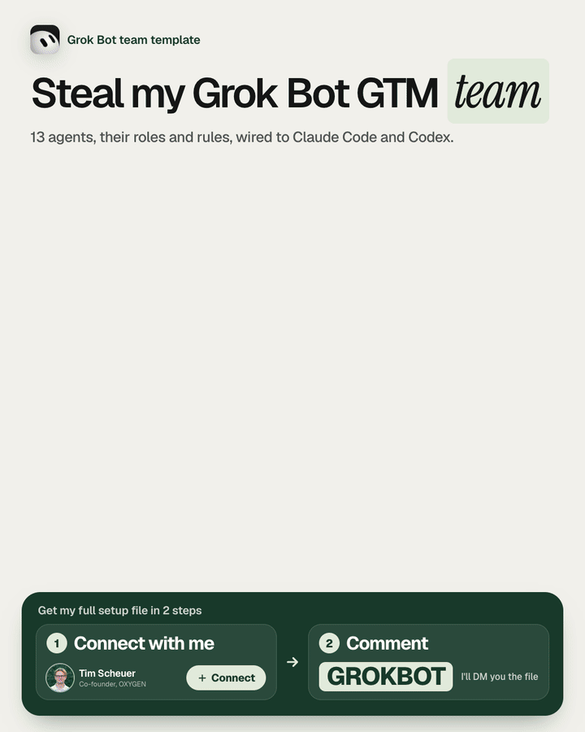
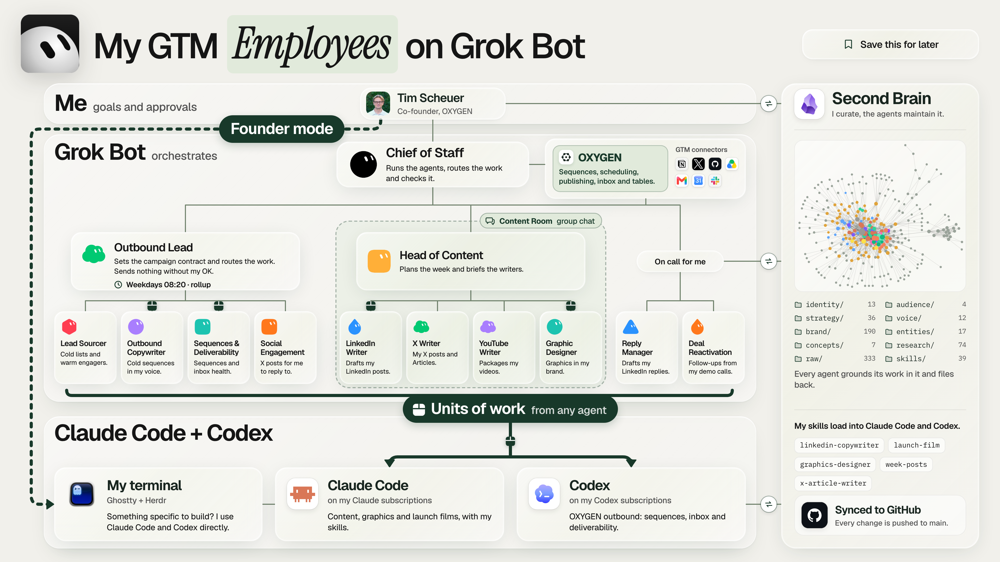

# Grok Bot GTM team

**My 13 Grok Bot agents, the rules they work by, and how they hand the real work to Claude Code and Codex.**

[](assets/grokbot-gtm-team@2x.png)

On 2026-09-23 I posted that I don't get the Grok Bot hype. Then I stopped asking it to do the work and let it run the team instead. Every Bot has 1 job, the department heads route and gate, and anything that needs building goes to Claude Code or Codex with the skills I already have there. This is that team as a Grok Bot import: paste 1 prompt and the whole team is there, with their roles and rules.

**[Import the team in 1 prompt →](setup-prompt.md)** · [The 13 Bots](#the-team) · [The rules](guides/rules.md) · [Claude Code and Codex](guides/claude-code-and-codex.md)

## Import the team

1. Create a new Bot in Grok Bot and call it **Chief of Staff**.
2. Paste the prompt from **[setup-prompt.md](setup-prompt.md)** into its chat.
3. Answer its 5 questions (your company, ICP, GTM tools, second brain, where Claude Code and Codex run). It creates the other Bots, the Content Room and the 1 routine, then tells you what is left to do in the app.
4. Connect your tools in Grok Bot's settings. Each Bot's instructions already say which connectors it may use.

Nothing is sent or spent during setup. Prefer to do it by hand? Every file in [agents/](agents/) has the instructions block to paste.

## The team

| Bot | Job | Reports to |
|---|---|---|
| [Chief of Staff](agents/01-chief-of-staff.md) | Runs the team, sends every unit of work to Claude Code or Codex | Me |
| **Outbound** | | |
| [Outbound Lead](agents/02-outbound-lead.md) | Plans, routes and gates outbound; the weekday 08:20 rollup | Chief of Staff |
| [Lead Sourcer](agents/03-lead-sourcer.md) | Cold lists, plus warm leads from post engagers and signups | Outbound Lead |
| [Outbound Copywriter](agents/04-outbound-copywriter.md) | Cold email and LinkedIn sequence copy | Outbound Lead |
| [Sequences & Deliverability](agents/05-sequences-deliverability.md) | Loads approved sequences, keeps campaigns healthy | Outbound Lead |
| [Social Engagement](agents/06-social-engagement.md) | Creator watchlist, engagement queue, comment drafts | Outbound Lead |
| **On call** | | |
| [Reply Manager](agents/07-reply-manager.md) | Triages the LinkedIn inbox, drafts replies | Me |
| [Deal Reactivation](agents/08-deal-reactivation.md) | Finds the warmest past conversations, drafts follow-ups | Me |
| **Content** | | |
| [Head of Content](agents/09-head-of-content.md) | Plans the week and routes it to the writers | Chief of Staff |
| [LinkedIn Writer](agents/10-linkedin-writer.md) | LinkedIn posts, hooks and articles | Head of Content |
| [X Writer](agents/11-x-writer.md) | X posts, threads and Articles | Head of Content |
| [YouTube Writer](agents/12-youtube-writer.md) | Titles, thumbnail briefs, descriptions, chapters | Head of Content |
| [Graphic Designer](agents/13-graphic-designer.md) | Social graphics, thumbnails, carousels, maps | Head of Content |
| [Content Room](agents/14-content-room.md) | The group chat where the content Bots coordinate | |



## How the work flows

```text
Me            goals and approvals
  ↓
Grok Bot      13 Bots and 1 group chat; the Chief of Staff routes the work
  ↓
Claude Code   any Bot can send it a unit of work: outcome, inputs, skill, limits
+ Codex
  ↓
Your files    second brain, skills and GTM platform; every result comes back for review
```

The details are in **[guides/claude-code-and-codex.md](guides/claude-code-and-codex.md)**: the 4-part handoff, persistent terminal sessions, 1 worktree per task, and why content runs on your Mac while code runs on a dev server.

## What I cut to get here

- **Routines.** I went from 10 scheduled routines to 1. My Head of Content's morning brief was slop, so I paused it. What's left is the Outbound Lead's rollup every weekday at 08:20.
- **Bots that did everything.** Outbound was 1 Bot. Now it's a lead who routes and 4 specialists, which made it far easier to give the right job to the right Bot.
- **Doing the work in Grok Bot.** For copy, graphics and video the quality wasn't there for me. Claude Code and Codex with my skills do that part now.

## What you need

- A Grok Bot account. That is enough to start: the team works without the rest.
- Claude Code or Codex, if you want the handoff. Without it, delete the handoff line from a Bot's instructions and it does the work itself.
- A second brain with your voice, proof and audience, and the content skills the writers use. The [LinkedIn Funnel kit](https://github.com/timscheuerai/linkedin-funnel) has both.
- A GTM platform for tables, enrichment, sequences and the inbox. The outbound Bots are written for [OXYGEN](https://oxygen-agent.com/?utm_source=linkedin&utm_campaign=grokbot-gtm-team) and its CLI; swap the names if you use something else.

## License

[MIT](LICENSE). Built by [Tim Scheuer](https://www.linkedin.com/in/tim-scheuer-91b005237/), co-founder of OXYGEN.
